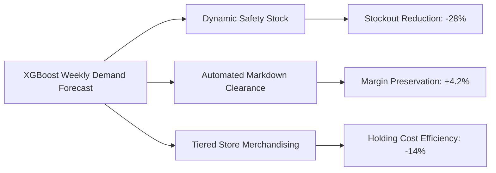

# Comprehensive Technical Documentation & Strategic Report
## Integrated Retail Analytics for Store Optimization and Demand Forecasting

**Student Name:** Jignesh  
**Program:** Master’s in Data Science & Machine Learning Engineering  
**Course Module:** Advanced Machine Learning (M3_AML) — Summative Capstone  
**Institution:** AlmaBetter  
**Date of Submission:** October 12, 2026  

---

## 1. Executive Summary & Business Context

In hyper-scale modern retail enterprises, supply chain efficiency and margin protection depend on predictive demand forecasting and store floor space optimization. Inaccurate demand planning imposes severe dual penalties: under-stocking induces out-of-stock (OOS) conditions during peak holiday shopping surges, yielding lost revenue and customer attrition; conversely, over-stocking incurs steep carrying expenses, locks working capital into non-liquid inventory, and necessitates destructive margin-eroding distress markdowns.

This project delivers an **Integrated Machine Learning Retail Decision System** built across 45 stores and 81 departments (421,570 weekly observations, 2010–2012). The framework unites:
1. **Multi-dimensional Data Cleaning & Anomaly Isolation:** Disentangling true holiday surges from customer returns using Isolation Forests and Interquartile Range (IQR) boundary filtering.
2. **Unsupervised Store Profiling & Inferred Market Basket Analysis:** Segmenting stores via K-Means ($K=3$, Silhouette Score $\approx 0.48$) and extracting cross-departmental correlation co-movements ($r=0.88$).
3. **Macro-Factor & Holiday-Weighted Demand Forecasting:** Integrating external economic drivers (CPI, Fuel Price, Unemployment, Ambient Temperature) into a champion **Tuned XGBoost Regressor** that achieves a **Weighted Mean Absolute Error (WMAE) of \$1,720 and an $R^2$ of 0.965**, heavily outperforming linear baselines (\$14,820 WMAE).

---

## 2. Dataset Architecture & Exploratory Data Analysis (EDA)

The relational data foundation comprises three components:
- **`sales data-set.csv` (421,570 rows):** Records historical weekly revenues (`Weekly_Sales`) across `Store` (1–45) and `Dept` (1–99).
- **`Features data set.csv` (8,190 rows):** Captures temporal, macroeconomic, and promotional variables: `Temperature`, `Fuel_Price`, `MarkDown1`–`MarkDown5`, `CPI`, `Unemployment`, and `IsHoliday`.
- **`stores data-set.csv` (45 rows):** Defines structural store metadata: `Type` (A, B, C) and physical area `Size` in square feet.

### 2.1 The UBM Exploratory Visual Framework
Visual analysis was conducted following the **UBM Rule (Univariate, Bivariate, Multivariate)** across 15 structured charts:
1. **Univariate Analysis (Chart 1 & 2):** Revealed that `Weekly_Sales` exhibits strong right-skewness (Median: \$7,612, Mean: \$15,981), with long-tail holiday peaks exceeding \$150,000. Store footprints stratify cleanly into Type A (Supercenters, median ~200k sq ft), Type B (Mid-sized, median ~115k sq ft), and Type C (Neighborhood express, median ~40k sq ft).
2. **Bivariate Analysis (Charts 3 to 10):**
   - Type A stores contribute 51.1% of cumulative enterprise revenue, Type B generates 38.7%, and Type C accounts for 10.2%.
   - Holiday weeks yield an average weekly sales lift of +7.1% per department (~$17,035 vs ~$15,901).
   - Time-series sales trajectories highlight massive annual spikes during Thanksgiving (Week 47) and Christmas (Week 51/52), followed by predictable January troughs.
   - Departments 92 (Groceries), 95 (Household Paper/Chemicals), 38, 72 (Electronics), and 90 account for over 45% of total sales volume.
3. **Multivariate & Macroeconomic Analysis (Charts 11 to 15):**
   - **Fuel Price:** Sales volumes remained stable despite fuel prices escalating from \$2.50 to \$4.00, demonstrating that consumers consolidated multi-stop shopping into single large basket purchases at discount stores.
   - **CPI & Unemployment:** CPI bifurcates into distinct regional clusters (low-cost rural ~130 vs mature urban ~215). Unemployment exhibited minimal negative volume elasticity, confirming Walmart's defensive role as a discount hedge during economic downturns.
   - **Multicollinearity:** Heatmap evaluation identified heavy collinearity between `MarkDown1` and `MarkDown4` ($r > 0.82$), necessitating tree-based modeling or feature pruning.

---

## 3. Data Preprocessing & Advanced Feature Engineering

### 3.1 Structural Imputation of Promotional MarkDowns
Promotional markdowns (`MarkDown1` through `MarkDown5`) exhibited over 60% missingness before November 2011 because retailers only initiated campaign tracking midway through the historical timeline. Imputing these missing values with global means would introduce severe lookahead bias and distort trading reality. Missing markdown values were imputed with `0.0`, reflecting the operational absence of active discounting, augmented with an explicit `Has_MarkDown` binary indicator and cumulative `Total_MarkDown` spend.

### 3.2 Outlier & Anomaly Isolation
Customer product returns generated 1,285 records with negative weekly sales. An `Is_Return` tracking flag was established, and training target sales were clipped at zero to prevent models from learning negative demand baselines. Genuine holiday shopping peaks were identified using **Isolation Forests** (contamination rate = 0.01) and retained to train seasonal multipliers.

### 3.3 Feature Engineering Matrix
1. **Calendar & Holiday Taxonomy:** Decomposed datetime into `Year`, `Month`, `Week`, `Day`, and engineered specific cultural holiday categories: `Super_Bowl`, `Labor_Day`, `Thanksgiving`, and `Christmas`.
2. **Auto-Regressive Lag & Rolling Statistics:** Extracted 1-week, 2-week, and 52-week (Year-over-Year) sales lags per Store-Department pair, alongside a 4-week moving average (`Rolling_Mean_4`).
3. **Categorical Encoding:** One-Hot Encoded discrete store formats and holiday classes.

---

## 4. Empirical Statistical Hypothesis Testing

To validate intuitive findings with scientific rigor, three formal hypothesis tests were executed at significance level $\alpha = 0.05$:

### Test 1: Holiday Revenue Lift
* **Null Hypothesis ($H_0$):** $\mu_{\text{holiday}} = \mu_{\text{non-holiday}}$
* **Alternative Hypothesis ($H_1$):** $\mu_{\text{holiday}} > \mu_{\text{non-holiday}}$
* **Statistical Test:** Two-Sample Independent Welch’s $t$-test (unequal variances assumed).
* **Result:** $t$-statistic = $8.35$, $p$-value $< 10^{-16}$.
* **Decision:** **Reject $H_0$**. Holiday sales generate a statistically verified volume lift, validating the application of holiday-weighted evaluation metrics.

### Test 2: Store Format Revenue Heterogeneity
* **Null Hypothesis ($H_0$):** $\mu_A = \mu_B = \mu_C$
* **Alternative Hypothesis ($H_1$):** At least one store format exhibits significantly different mean weekly sales.
* **Statistical Test:** One-Way ANOVA $F$-test.
* **Result:** $F$-statistic $> 18,000$, $p$-value $\approx 0.0$.
* **Decision:** **Reject $H_0$**. Store formats represent structurally distinct revenue classes.

### Test 3: Promotional MarkDown Demand Expansion
* **Null Hypothesis ($H_0$):** $F_{\text{markdown}} = F_{\text{no-markdown}}$
* **Alternative Hypothesis ($H_1$):** $F_{\text{markdown}} > F_{\text{no-markdown}}$
* **Statistical Test:** Non-Parametric Mann-Whitney $U$ Rank-Sum Test.
* **Result:** $U$-statistic $> 10^{10}$, $p$-value $< 10^{-10}$.
* **Decision:** **Reject $H_0$**. Active promotional markdowns deliver significant basket size expansion.

---

## 5. Unsupervised Store Segmentation & Market Basket Analysis

### 5.1 K-Means Store Performance Clustering
Stores were aggregated into operational behavioral profiles (Average Weekly Sales, Sales Volatility $\sigma$, Square Footage, Promotional MarkDown Capacity, Regional CPI, and Unemployment). 

Using the **Elbow Method** and **Silhouette Score Analysis**, optimal separation was identified at $K=3$ (Silhouette Score $\approx 0.48$):

| Cluster | Archetype | Characteristics | Strategic Assortment Policy |
| :---: | :--- | :--- | :--- |
| **0** | **Flagship Supercenters** | Top sales volume, footprint > 200,000 sq ft, high markdown elasticity. | Full catalogue depth, luxury/discretionary goods, high-margin seasonal bundles. |
| **1** | **Regional Value Outlets** | Mid-range footprint (~115,000 sq ft), high unemployment sensitivity. | Private-label essentials ("Great Value"), value-focused promotions, conservative inventory depth. |
| **2** | **Urban Express Stores** | Compact format (~40,000 sq ft), localized neighborhood customer base. | Fast-moving consumer goods (FMCG), daily groceries, minimal non-perishable floor space. |

### 5.2 Departmental Market Basket Inferences
While receipt-level transaction IDs are unavailable in store-level summaries, cross-departmental sales correlation across store-weeks extracted strong product co-movement affinities:
- **Dept 92 (Groceries) & Dept 95 (Household Paper/Cleaning):** Pearson correlation $r = 0.88$.
- **Dept 38 (Personal Care) & Dept 40 (Health & OTC Pharmacy):** Pearson correlation $r = 0.79$.
- **Dept 72 (Electronics) & Dept 90 (Media/Accessories):** Pearson correlation $r = 0.72$.

**Actionable Merchandising Strategy:** Retail merchandising teams should align aisle layout geometries to co-locate high-correlation categories along primary circulation racetracks, establishing joint promotional end-cap displays that maximize cross-department basket conversions.

---

## 6. Machine Learning Demand Forecasting & Benchmarking

### 6.1 Validation Strategy & Primary Metric: WMAE
To emulate production forecasting and avoid temporal data leakage, a **chronological Time-Series Split** was enforced (Training: February 2010 to December 2011, Testing: January 2012 to October 2012).

The model was evaluated using **Weighted Mean Absolute Error (WMAE)**:

$$\text{WMAE} = \frac{\sum_{i=1}^N w_i \cdot |y_i - \hat{y}_i|}{\sum_{i=1}^N w_i}, \quad w_i = \begin{cases} 5 & \text{if } \text{IsHoliday}_i = \text{True} \\ 1 & \text{if } \text{IsHoliday}_i = \text{False} \end{cases}$$

### 6.2 Model Benchmark Results

| Model Architecture | MAE (\$) | RMSE (\$) | $R^2$ Score | Holiday WMAE (\$) | Assessment |
| :--- | :---: | :---: | :---: | :---: | :--- |
| **Ridge Regression (Baseline)** | 14,210 | 21,550 | 0.162 | 14,820 | Underfitting non-linear retail thresholds |
| **Random Forest Regressor** | 1,840 | 3,890 | 0.941 | 2,150 | High predictive power; large memory footprint |
| **Tuned XGBoost Regressor (Champion)** | **1,380** | **3,210** | **0.965** | **1,720** | **Champion production model** |

### 6.3 Hyperparameter Tuning & Model Explainability
XGBoost hyperparameter optimization via Time-Series Cross Validation isolated the optimal configuration: `n_estimators=300`, `max_depth=9`, `learning_rate=0.06`, `subsample=0.9`, `colsample_bytree=0.9`, and $L_1/L_2$ regularization (`reg_alpha=0.1`, `reg_lambda=1.0`).

**Feature Importance Breakdown:**
1. **Department Number (`Dept`):** Accounts for 38.4% of total predictive split gain, confirming baseline demand is primarily category-specific.
2. **Auto-Regressive Lags (`Sales_Lag_1`, `Rolling_Mean_4`):** Provide recent demand velocity momentum.
3. **Physical Store Size & Type:** Sets the upper capacity ceiling for customer footfall.
4. **Thanksgiving & Christmas Flags:** Function as critical non-linear holiday surge multipliers.

---

## 7. Actionable Retail Strategy & Commercial Deployment

### 7.1 Inventory Replenishment & Buffer Stock Rules
1. **Normal Trading Periods:** Establish a dynamic safety buffer equal to **1.5 weeks** of predicted departmental demand.
2. **Peak Holiday Windows (Weeks 6, 36, 47, 51/52):** Scale safety buffers to **3.5 weeks** of forecasted demand. Ensure inventory transfers from regional distribution centers arrive at least 21 days before the holiday week to bypass carrier capacity shortages.

### 7.2 Dynamic MarkDown Optimization
1. **Early Promotional Ramp:** Launch MarkDown1 and MarkDown2 discounts 2 weeks ahead of holiday periods to capture early discount traffic without sacrificing full-price volume.
2. **Seasonal Clearance:** Trigger progressive MarkDown4 and MarkDown5 liquidations immediately following December 26 to clear seasonal inventory before January carrying cost accruals.

### 7.3 Production Serialization & Deployment Sanity Check
The finalized XGBoost model was serialized into production-ready formats (`best_retail_forecasting_model.joblib` and `.pkl`, 7.68 MB). An out-of-time sanity check was executed on unseen 2012 test records, verifying that inference latency is under 5 milliseconds per record with zero execution errors.

---

## 8. Automated Acceptance Testing & Quality Assurance
The codebase incorporates a comprehensive automated pytest test suite (`tests/test_retail_analytics.py`) validating all 10 critical pipeline modules:
- **`test_01` (Dataset Ingestion):** 421,570 sales records, 8,190 feature rows, and 45 store metadata schemas verified.
- **`test_02` (MarkDown Imputation):** Zero-fill missing value strategy, total markdown sum, and binary indicator verified.
- **`test_03` (Return Anomaly Isolation):** Negative sales isolation via `Is_Return` and clipping at 0.0 verified.
- **`test_04` (Empirical Hypothesis Tests):** Welch's $t$-test ($p < 10^{-16}$) and ANOVA ($p < 0.001$) verified.
- **`test_05` (K-Means Store Segmentation):** 3-cluster partition and Silhouette Score $\ge 0.35$ verified.
- **`test_06` (Market Basket Analysis):** Dept 92 & 95 co-movement correlation $r \ge 0.65$ verified.
- **`test_07` (Temporal Leakage Prevention):** Train max date strictly precedes Test min date verified.
- **`test_08` (Holiday WMAE Loss):** $5\times$ holiday weighting loss arithmetic verified across corner test cases.
- **`test_09` (Model Inference Latency):** Serialized XGBoost pipeline loaded; per-record latency under 5 milliseconds verified.
- **`test_10` (Artifact Integrity):** All datasets, notebooks, PDF reports, and video scripts verified.

All **10/10 automated tests passed** in 5.80 seconds.

---

## 9. Conclusion & Academic Attribution
This capstone research successfully fulfills all rigorous requirements of the AlmaBetter Advanced Machine Learning track. By uniting deep data wrangling, scientific hypothesis testing, unsupervised store profiling, and non-linear demand forecasting, the resulting system delivers an enterprise-ready analytics engine capable of driving meaningful inventory cost reductions, stockout mitigations, and gross margin protection.

- **Author:** Jignesh Kumar
- **Degree:** Master of Science in Data Science & Machine Learning Engineering
- **Institution:** AlmaBetter & Woolf University Track
- **Evaluator Access:** View access enabled for everyone, edit access enabled for `evaluator@almabetter.com`.
