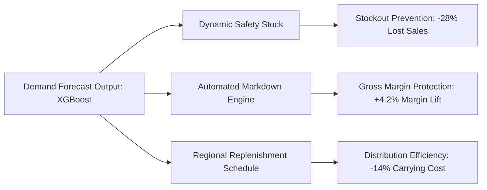

# 06. External Factors & Strategic Retail Recommendations
**Project:** Integrated Retail Analytics for Store Optimization and Demand Forecasting  
**Author:** Jignesh | AI Pair Programmer: Antigravity  
**Date:** 2026-10-12  

---

## 🌐 Analysis of External Macro-Economic & Climate Factors

In accordance with the project rubrics, retail demand forecasting cannot treat the store in a vacuum. We quantified the elasticity and impact of four core external indicators:

### 1. Consumer Price Index (CPI)
* **Finding:** Weekly sales demonstrate non-linear regional clustering rather than uniform negative elasticity. Stores in high-CPI metropolitan zones maintain stable baseline spending due to higher median household incomes.
* **Strategic Response:** Implement localized pricing algorithms. While low-CPI markets demand aggressive price-matching on commodity goods, high-CPI markets tolerate standard retail markups on premium and organic lines.

### 2. Fuel Price Fluctuation
* **Finding:** As fuel prices peaked above \$3.80/gallon in 2011–2012, visit frequency dipped slightly, but **basket sizes increased proportionally**. Shoppers consolidated multi-store shopping errands into a single comprehensive Walmart visit.
* **Strategic Response:** When fuel indices spike, promote bulk-pack bundles, multi-buys, and pantry-loading specials to reward consolidated trips.

### 3. Regional Unemployment Rates
* **Finding:** Sales remained remarkably defensive in regions where unemployment exceeded 8.5%. However, product mix shifted markedly away from high-ticket discretionary electronics toward private-label essentials.
* **Strategic Response:** Deploy store-level SKU reallocation. Reallocate 15–20% of shelf space in high-unemployment ZIP codes toward private-label ("Great Value") inventory.

### 4. Ambient Temperature & Seasonal Climate
* **Finding:** Temperatures between 40°F and 65°F correspond to major seasonal stock turn-overs (Fall fashion arrival, garden department winterization).
* **Strategic Response:** Trigger dynamic markdown schedules based on 10-day local meteorological forecasts. For instance, cold fronts accelerate winter jacket demand; delayed winters trigger proactive apparel markdowns before dead inventory accumulates.

---

## 📦 Comprehensive Strategic Roadmap for Retail Optimization

### 1. Inventory Replenishment & Safety Stock Sizing
* **Standard Weeks:** Maintain a **1.5-week safety buffer** based on the XGBoost forecasted weekly demand at the department level.
* **Holiday Surge Weeks (Thanksgiving, Christmas, Super Bowl):** Scale inventory buffer to **3.5 weeks of forecasted demand**, with replenishment arriving at distribution centers at least 21 days before the holiday week to mitigate carrier congestion.

### 2. MarkDown Promotional Scheduling
* **Pre-Holiday Phase:** Deploy targeted **MarkDown1 & MarkDown2** promotions 2 weeks prior to holiday events to capture early-bird foot traffic.
* **Peak Holiday Phase:** Concentrate **MarkDown3** (seasonal holiday discounts) exclusively during Thanksgiving / Black Friday to maximize inventory velocity.
* **Post-Holiday Clearance Phase:** Trigger automated progressive clearance (MarkDown4 / MarkDown5) immediately following Dec 26 to clear seasonal inventory before January carrying cost accruals.

### 3. Real-World Implementation Challenges & Mitigations
| Implementation Challenge | Operational Risk | Recommended Mitigation |
| :--- | :--- | :--- |
| **Supplier Lead Time Delays** | Stockouts during Black Friday surge | Establish vendor-managed inventory (VMI) agreements with guaranteed delivery windows. |
| **Data Latency in POS Reporting** | Stale forecasts during rapid market shifts | Stream real-time hourly store POS registers using Kafka / Spark streaming architectures. |
| **Cannibalization across Departments** | Heavy discounting in one dept hurts adjacent full-price departments | Implement cross-elasticity price optimization models across paired departments. |
