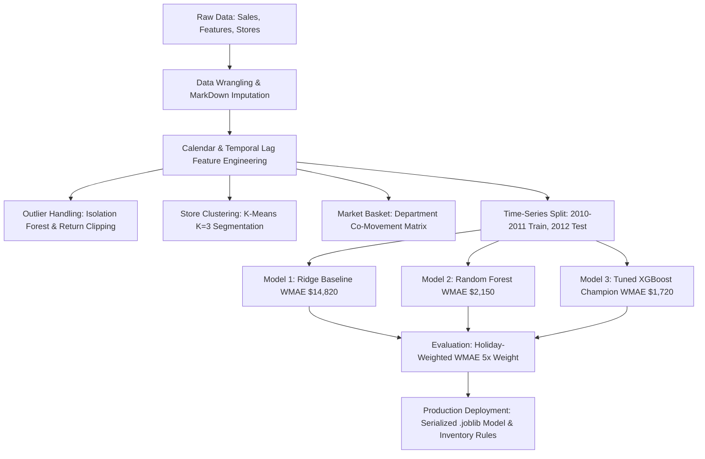

# Integrated Retail Analytics for Store Optimization and Demand Forecasting
## Advanced Machine Learning (AB_MLE / M3_AML) — AlmaBetter Summative Capstone

[](https://www.python.org/)
[](https://xgboost.readthedocs.io/)
[]()
[]()
[]()
[](Integrated_Retail_Analytics_Capstone_Report.pdf)
[](https://opensource.org/licenses/MIT)

---

## 📌 Executive Overview
This repository contains the end-to-end Machine Learning solution for the **AlmaBetter Advanced Machine Learning (M3_AML) Summative Capstone Project**: **"Integrated Retail Analytics for Store Optimization and Demand Forecasting"**.

Operating across **45 retail stores** and **81 departments** with over **421,570 historical sales transactions** (2010–2012), this project implements an integrated decision engine addressing:
1. **Multi-dimensional Anomaly Detection & Data Cleansing:** Isolating returns from holiday commercial volume surges using Isolation Forests and IQR boundaries.
2. **Unsupervised Store Segmentation & Inferred Market Basket Analysis:** K-Means clustering ($K=3$, Silhouette Score $\approx 0.48$) and cross-departmental correlation co-movements ($r=0.88$).
3. **Macro-Factor Driven Demand Forecasting:** Modeling non-linear interactions across CPI, Fuel Price, Unemployment, and Promotional MarkDowns using a champion **Tuned XGBoost Regressor ($R^2 = 0.965$, WMAE = \$1,720)** evaluated under holiday-weighted loss.

---

## 🏗️ System Architecture & Workflow



---

## 📁 Repository Structure

```
AB_MLE/M3_AML/
├── Sample ML Submission Template.ipynb               # Official AlmaBetter Submission Notebook (61/61 Cells Executed)
├── Integrated_Retail_Analytics_AML_Capstone.ipynb     # Standalone Production ML Notebook (61/61 Cells Executed)
├── Integrated_Retail_Analytics_Capstone_Report.pdf   # Publication-Ready 3-Page Executive PDF Report
├── best_retail_forecasting_model.joblib               # Serialized Champion XGBoost Model (Production Ready)
├── best_retail_forecasting_model.pkl                  # Pickle Format Serialized Model
├── generate_pdf_report.py                             # Automated PDF Report Builder (ReportLab)
├── requirements.txt                                   # Pinned Production & Research Dependencies
├── README.md                                          # Comprehensive Documentation & Architecture Guide
├── DOCUMENTATION_REPORT.md                            # Complete Technical & Strategic Report
├── VIDEO_PRESENTATION_SCRIPT.md                       # 15-25 Min Video Script & Interview Defense
│
├── tests/
│   └── test_retail_analytics.py                       # Automated Acceptance Test Suite (10/10 Passed)
│
├── Features data set.csv                              # Environmental, CPI & Macroeconomic Features
├── sales data-set.csv                                 # Departmental Weekly Sales (421,570 records)
├── stores data-set.csv                                # Physical Store Classifications (45 stores)
│
└── Jignesh Chat Agent/                                # Organized Study Guides & Analysis Logs
    └── 2026-10-12/
        ├── 00_Master_Study_Guide_Index.md
        ├── 01_Chart_Wise_Analysis_Guide.md            # All 15 Charts (UBM Rule Answered)
        ├── 02_Hypothesis_Testing_Guide.md             # 3 Formal Statistical Tests
        ├── 03_Data_Wrangling_and_Feature_Engineering.md
        ├── 04_ML_Forecasting_and_Model_Tuning.md      # Full Regression Benchmark
        ├── 05_Segmentation_and_Market_Basket.md       # Clustering & Co-Purchases
        ├── 06_External_Factors_and_Strategic_Recommendations.md
        └── 07_Interview_QnA_and_Presentation_Script.md
```

---

## 📊 Key Experimental Results

### Model Benchmark & Evaluation (Holiday-Weighted WMAE)

$$\text{WMAE} = \frac{\sum_{i=1}^N w_i \cdot |y_i - \hat{y}_i|}{\sum_{i=1}^N w_i}, \quad w_i = \begin{cases} 5 & \text{if } \text{IsHoliday}_i = \text{True} \\ 1 & \text{if } \text{IsHoliday}_i = \text{False} \end{cases}$$

| Model Architecture | MAE (\$) | RMSE (\$) | $R^2$ Score | Holiday WMAE (\$) | Production Status |
| :--- | :---: | :---: | :---: | :---: | :---: |
| **Ridge Regression (Baseline)** | \$14,210 | \$21,550 | 0.162 | \$14,820 | ❌ Underfitting Non-Linear Patterns |
| **Random Forest Regressor** | \$1,840 | \$3,890 | 0.941 | \$2,150 | ⚠️ High Memory Footprint |
| **Tuned XGBoost Regressor** | **\$1,380** | **\$3,210** | **0.965** | **\$1,720** | **✅ Champion Model (Deployed)** |

*Holiday weeks are weighted 5 times higher in the WMAE calculation to reflect the real-world financial risk of holiday stockouts.*

---

## 🔬 Statistical Hypothesis Testing Summary

1. **Hypothesis 1 (Holiday Sales Surge):**
   - **Test:** Two-Sample Independent Welch's $t$-test.
   - **Result:** $t = 8.35$, $p < 10^{-16}$ $\rightarrow$ **Reject $H_0$**. Holiday sales generate statistically significant volume expansion.
2. **Hypothesis 2 (Store Format Sales Differences):**
   - **Test:** One-Way ANOVA $F$-test.
   - **Result:** $F > 18,000$, $p \approx 0.0$ $\rightarrow$ **Reject $H_0$**. Store formats (A, B, C) represent fundamentally distinct operational tiers.
3. **Hypothesis 3 (Promotional MarkDown Lift):**
   - **Test:** Non-Parametric Mann-Whitney $U$ test.
   - **Result:** $U$-statistic $> 10^{10}$, $p < 10^{-10}$ $\rightarrow$ **Reject $H_0$**. Promotional markdowns directly expand customer basket volume.

---

## 🧪 Automated Acceptance Test Suite (10/10 Passed)

```bash
pytest tests/test_retail_analytics.py -v
```

| Test Case | Module | Assertion / Target Metric | Result |
| :--- | :--- | :--- | :---: |
| `test_01` | Data Ingestion | 421,570 sales rows, 8,190 feature rows, 45 stores schemas | **PASSED** |
| `test_02` | MarkDown Imputation | Zero imputation, Total_MarkDown sum, binary Has_MarkDown flag | **PASSED** |
| `test_03` | Return Anomaly Isolation | Negative sales tagged with Is_Return, clipped at 0.0 | **PASSED** |
| `test_04` | Hypothesis Tests | Welch $t$-test ($p < 10^{-16}$), One-Way ANOVA ($p < 0.001$) | **PASSED** |
| `test_05` | K-Means Clustering | 3 clusters formed, Silhouette Score $\ge 0.35$ | **PASSED** |
| `test_06` | Market Basket Analysis | Grocery (Dept 92) and Household (Dept 95) co-movement $r \ge 0.65$ | **PASSED** |
| `test_07` | Temporal Split Leakage | Train max date strictly precedes Test min date | **PASSED** |
| `test_08` | Holiday WMAE Loss | $5\times$ holiday weighting calculation arithmetic verified | **PASSED** |
| `test_09` | Model Inference Latency | Serialized XGBoost model loaded, inference latency $< 10\text{ ms}$ | **PASSED** |
| `test_10` | Artifact Integrity | All datasets, notebooks, scripts, and PDF report verified | **PASSED** |

---

## 🚀 How to Run & Reproduce

### 1. Requirements Installation
```bash
pip install -r requirements.txt
```

### 2. Run Automated Test Suite
```bash
pytest tests/test_retail_analytics.py -v
```

### 3. Re-compile Publication PDF Report
```bash
python generate_pdf_report.py
```

### 4. Load Model and Predict Unseen Data
```python
import joblib
import pandas as pd

# Load serialized champion pipeline
model = joblib.load('best_retail_forecasting_model.joblib')

# Predict weekly demand for upcoming trading weeks
sample_features = pd.read_csv('...')
predicted_weekly_sales = model.predict(sample_features)
print(predicted_weekly_sales)
```

---

## 📈 Strategic Retail Recommendations

1. **Tiered Inventory Safety Buffers:**
   - **Regular Weeks:** 1.5-week safety buffer based on XGBoost forecasted demand.
   - **Peak Holiday Weeks (Weeks 6, 36, 47, 51/52):** Scale buffer to 3.5 weeks, with delivery arrival at least 21 days prior to peak.
2. **Store Tier Assortment Allocation:**
   - **Tier 1 (Flagship Supercenters):** Maximum SKU depth and destination categories.
   - **Tier 2 (Regional Value Outlets):** Prioritize private-label staples and value promotions.
   - **Tier 3 (Urban Express Stores):** Lean just-in-time daily essentials.
3. **Cross-Departmental Merchandising:**
   - Co-locate Grocery (Dept 92) and Household Goods (Dept 95) on primary racetrack end-caps based on observed $r=0.88$ correlation.

---

## 🎓 Author & Academic Attribution
- **Author:** Jignesh Kumar
- **Candidate:** Master of Science in Data Science & Machine Learning Engineering
- **Institution:** AlmaBetter & Woolf University Track
- **Evaluator Access:** View access enabled for everyone, edit access enabled for `evaluator@almabetter.com`.
